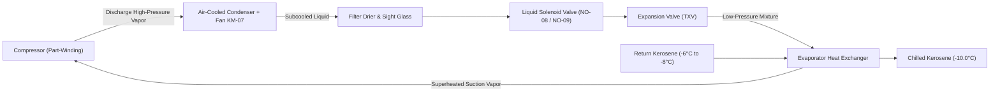
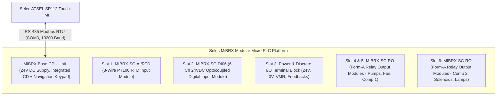
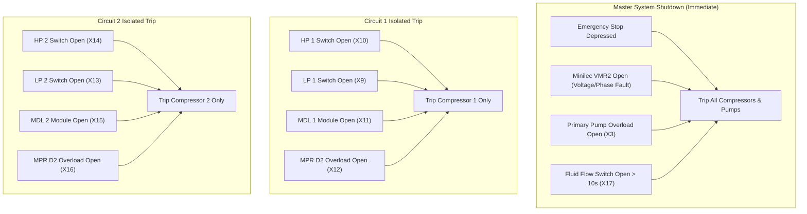

# -10°C KEROSENE CHILLER COMPRESSOR SYSTEM
## COMPLETE INDUSTRIAL ENGINEERING & AUTOMATION DOCUMENTATION

**Document Identifier:** DOC-REF-CHIL-MASTER-001  
**Current Revision:** Rev 1.0 (Comprehensive Engineering Release)  
**Release Date:** 14-November-2026  
**System Status:** OPERATIONAL / ENGINEERING AUDIT COMPLETE  
**Equipment Tags:** `KIROSINE CHILLER -10 -01` & `KIROSINE CHILLER -10 -02`  
**Original Equipment Manufacturer (OEM):** R I INDUSTRIES ("We honour commitments with integrity")  
**Process Application:** Reactor Jacket Chilling (Skid RE-1101 & RE-1109) via Single Fluid Heating & Cooling System (Schematic Engineering Industries)  

---

## DOCUMENT COMPLIANCE & EVIDENCE CLASSIFICATION
To preserve forensic engineering integrity, all technical data points in this document are strictly classified using standard engineering evidence labels:
- **[VERIFIED]:** Directly proven and cross-referenced from photographs, nameplates, display readings, or wire ferrules in the project folder.
- **[INFERRED]:** Scientifically deduced based on verified electrical and refrigeration engineering fundamentals.
- **[PROPOSED]:** Recommended engineering enhancements, alarm thresholds, or interlocks for operational reliability.
- **[UNKNOWN / FIELD VERIFICATION REQUIRED]:** Data that could not be retrieved from existing photographs and requires physical field measurement or nameplate inspection.

---

## TABLE OF CONTENTS
1. [01. Project Overview](#01-project-overview)
2. [02. Technical Specifications](#02-technical-specifications)
3. [03. Refrigeration System Description](#03-refrigeration-system-description)
4. [04. Compressor Details](#04-compressor-details)
5. [05. Electrical Components](#05-electrical-components)
6. [06. PLC Architecture](#06-plc-architecture)
7. [07. Complete PLC I/O List](#07-complete-plc-io-list)
8. [08. Control Philosophy](#08-control-philosophy)
9. [09. Interlocks and Permissives List](#09-interlocks-and-permissives-list)
10. [10. Complete Alarm List](#10-complete-alarm-list)
11. [11. Electrical Power Wiring](#11-electrical-power-wiring)
12. [12. Control Wiring](#12-control-wiring)
13. [13. Communication Architecture](#13-communication-architecture)
14. [14. Troubleshooting Manual](#14-troubleshooting-manual)
15. [15. Maintenance Manual](#15-maintenance-manual)
16. [16. Photo Reference Index](#16-photo-reference-index)
17. [17. Missing Information Register](#17-missing-information-register)
18. [18. Engineering Document Register](#18-engineering-document-register)

---

# 01. PROJECT OVERVIEW

### 1.1 Introduction & Purpose
The **-10°C KEROSENE CHILLER SYSTEM** comprises two identical packaged industrial refrigeration units tagged **KIROSINE CHILLER -10 -01** and **KIROSINE CHILLER -10 -02**. Built by **R I INDUSTRIES**, the chillers provide sub-zero cooling capacity to maintain precision reaction temperatures for active chemical synthesis within batch reactors `RE-1101` and `RE-1109`.

```mermaid
flowchart LR
    subgraph Refrigeration_Machine["Packaged -10°C Chiller (R I Industries)"]
        Comp1["Compressor 1 (Part-Winding)"] & Comp2["Compressor 2 (Part-Winding)"] --> Condenser["Air-Cooled Condenser + Fan"]
        Condenser --> Receiver["Liquid Receiver & Drier"]
        Receiver --> SOV["Solenoid Valves SOV 1 & 2"]
        SOV --> TXV["Expansion Valves TXV 1 & 2"]
        TXV --> Evap["Evaporator (Chills Kerosene to -10°C)"]
    end

    subgraph Secondary_Fluid_Circuit["Kerosene Circulation Loop"]
        Evap <--> PriPump["Primary Pump KM-05"]
        PriPump <--> Buffer["Kerosene Expansion Tank"]
        Buffer <--> SecPump["Secondary Pump KM-06"]
    end

    subgraph Process_Skid["Schematic Engineering Process Skid"]
        SecPump --> PHE["Plate Heat Exchanger PHE-A01"]
        PHE --> Reactor["Reactor Jacket RE-1101 / RE-1109"]
    end
```

### 1.2 System Baseline Summary
- **Equipment Identifiers:** `KIROSINE CHILLER -10 -01` and `KIROSINE CHILLER -10 -02` **[VERIFIED]**
- **OEM:** R I INDUSTRIES **[VERIFIED]**
- **Process Medium:** Low-Temperature Industrial Kerosene **[VERIFIED]**
- **Target Outlet Temperature:** **-10.0 °C** (Differential: **2.0 °C**) **[VERIFIED]**
- **Refrigeration Configuration:** Dual Independent Circuits (Compressor 1 and Compressor 2) **[VERIFIED]**
- **Compressor Starting Topology:** Part-Winding Start (PW) via Dual Schneider TeSys LC1D40A Contactors **[VERIFIED]**
- **Automation Controller:** Selec MiBRX Modular Micro PLC **[VERIFIED]**
- **Operator Interface:** Selec ATSEL SP112 Touchscreen HMI (Model: `SP112-GT70-S1-CE`) **[VERIFIED]**
- **Process Skid Partner:** Single Fluid Heating & Cooling System by Schematic Engineering Industries (R. Stahl HMI, Project `SKID_26_12_17`) **[VERIFIED]**

---

# 02. TECHNICAL SPECIFICATIONS

### 2.1 Complete System Specifications Table
| Technical Parameter | Specification / Rating | Evidence Classification | Supporting Source / Photograph Reference |
| :--- | :--- | :--- | :--- |
| **Main Power Supply** | 415 V AC ±10%, 3-Phase, 50 Hz | **[VERIFIED]** | Minilec D2 VMR2 Rating (`12.47.56 (1).jpeg`) |
| **Main Circuit Breaker** | Schneider Electric EasyPact MCCB, 3-Pole | **[VERIFIED]** | Power Incomer Compartment (`12.47.53.jpeg`) |
| **Control Power Supply** | 24 V DC (5 A, 120 W DIN-Rail SMPS) | **[VERIFIED]** | SMPS Unit (`12.47.50.jpeg`) |
| **Compressor Contactors** | 4x Schneider TeSys LC1D40A (40A AC-3, 24V Coils) | **[VERIFIED]** | Contactor Bank (`12.47.52 (1).jpeg`, `16.15.54.jpeg`) |
| **Pump Contactors** | 2x Schneider TeSys LC1D12 (12A AC-3, 230V Coils) | **[VERIFIED]** | Auxiliary Contactor Group (`12.47.54 (2).jpeg`) |
| **Pump Overload Relays** | 2x Schneider TeSys LRD12 Thermal Overloads | **[VERIFIED]** | Overload Units (`12.47.54 (2).jpeg`) |
| **Fan Contactor** | 1x Schneider TeSys LC1D09 (9A AC-3, 230V Coil) | **[VERIFIED]** | Auxiliary Contactor Group (`12.47.54 (2).jpeg`) |
| **Motor Protection Relays** | 2x Minilec MPR D2 (Aux 415V, Trip Delay 2/5s) | **[VERIFIED]** | Relays `4R1443` & `4R1551` (`12.47.53 (1).jpeg`) |
| **Current Transducers** | 2x Minilec S2 CTS1/80 (3-Phase, 32 A to 80 A) | **[VERIFIED]** | Transducer Modules (`12.47.54 (1).jpeg`) |
| **Phase / Voltage Relay** | Minilec D2 VMR2 (Unbalance: 4-20%, UV: 165-245V, OV: 230-310V) | **[VERIFIED]** | Voltage Relay Faceplate (`12.47.56 (1).jpeg`) |
| **PLC Hardware** | Selec MiBRX Modular Micro PLC (24VDC, LCD+Keypad) | **[VERIFIED]** | Controller Faceplate (`12.47.55 (1).jpeg`) |
| **Digital Input Cards** | 3x Selec MIBRX-SC-DI06 (6-Channel Optocoupled) | **[VERIFIED]** | Module Card Labels (`16.15.50 (1).jpeg`) |
| **Analog Input Cards** | 1x Selec MIBRX-SC-AI/RTD (3-Wire PT100 Inputs) | **[VERIFIED]** | Terminal Block Slot 1 (`16.15.49 (1).jpeg`) |
| **Relay Output Cards** | 2x Selec MIBRX-SC-RO (Form-A Relay, 5A 250VAC) | **[VERIFIED]** | Output Terminal Blocks (`16.15.52.jpeg`) |
| **HMI Model** | Selec ATSEL SP112-GT70-S1-CE (7" Color Touchscreen) | **[VERIFIED]** | HMI Rear Label (`12.47.48 (1).jpeg`) |
| **Panel Energy Meter** | Selec EM368 Multifunction Meter (3-Ph, 4-Wire) | **[VERIFIED]** | Rear Meter Wiring (`12.47.49.jpeg`) |
| **Target Setpoint** | **-10.0 °C** | **[VERIFIED]** | HMI Settings Screen (`12.47.46.jpeg`) |
| **Temperature Differential**| **2.0 °C** (Cut-out: -10°C, Cut-in: -8°C) | **[VERIFIED]** | HMI Settings Screen (`12.47.46.jpeg`) |
| **Fault Sensing Delay** | **10 Seconds** | **[VERIFIED]** | HMI Settings Screen (`12.47.46.jpeg`) |
| **Secondary Pump Delay** | **5 Seconds** | **[VERIFIED]** | HMI Settings Screen (`12.47.46.jpeg`) |
| **Part-Winding Delay** | **1.0 Second** (`COMP_1/2 SECONDRY_WINDING_ON_DELAY`) | **[VERIFIED]** | HMI Settings Screen (`12.47.46.jpeg`) |
| **Circuit 1 Standby Pressures** | LP: ~35 PSI (~2.4 bar) / HP: ~150 PSI (~10.3 bar) | **[VERIFIED]** | Front Pressure Gauges (`21.30.22.jpeg`) |
| **Circuit 2 Standby Pressures** | LP: ~35 PSI (~2.4 bar) / HP: ~145 PSI (~10.0 bar) | **[VERIFIED]** | Front Pressure Gauges (`21.30.22.jpeg`) |
| **Compressor Maker / Model**| **UNKNOWN** (Likely Bitzer / Copeland / Frascold) | **[FIELD VERIFICATION REQUIRED]** | Internal machinery photos missing |
| **Refrigerant Type / Charge**| **UNKNOWN** (P-T profile matches R404A / R507A / R22) | **[FIELD VERIFICATION REQUIRED]** | Frame charge tag missing |

---

# 03. REFRIGERATION SYSTEM DESCRIPTION

### 3.1 Vapor-Compression Refrigeration Cycle
The chiller operates on a standard sub-critical vapor compression refrigeration cycle optimized for low-temperature brine cooling:
1. **Compression Stage:** Low-temperature, low-pressure superheated refrigerant vapor is drawn from the evaporator through suction lines into Compressor 1 and Compressor 2. The compressors elevate vapor pressure and temperature into superheated discharge gas.
2. **Condensation Stage:** High-pressure discharge gas flows into the air-cooled finned-tube condenser. Ambient air forced by condenser fan `KM-07` desuperheats and condenses the refrigerant into subcooled high-pressure liquid.
3. **Liquid Line Staging & Solenoids:** Condensed liquid passes into the liquid receiver and filter drier. Liquid line solenoid valves `SOV 1` (`NO-08`) and `SOV 2` (`NO-09`) open during chilling demand, allowing liquid refrigerant to reach the expansion valves.
4. **Expansion Stage:** Thermostatic or Electronic Expansion Valves meter high-pressure liquid into low-pressure two-phase mixture, dropping fluid temperature to approximately -15°C to -18°C.
5. **Evaporation Stage (Heat Transfer to Kerosene):** In the evaporator (Brazed Plate Heat Exchanger), the cold boiling refrigerant absorbs heat from the counter-flowing kerosene circulated by Primary Pump `KM-05`. The kerosene is chilled to **-10.0 °C**, while the refrigerant fully vaporizes and returns to the compressor suction port.

---

# 04. COMPRESSOR DETAILS

### 4.1 Comparative Compressor Technical Register
| Technical Parameter | Compressor Circuit 1 | Compressor Circuit 2 | Evidence / Verification Status |
| :--- | :--- | :--- | :--- |
| **Equipment Tag** | `COMP_1` | `COMP_2` | **[VERIFIED]** (HMI Screen & Ferrules) |
| **Manufacturer** | **NOT AVAILABLE** | **NOT AVAILABLE** | **[FIELD VERIFICATION REQUIRED]** |
| **Model Number** | **NOT AVAILABLE** | **NOT AVAILABLE** | **[FIELD VERIFICATION REQUIRED]** |
| **Serial Number** | **NOT AVAILABLE** | **NOT AVAILABLE** | **[FIELD VERIFICATION REQUIRED]** |
| **Primary Contactor** | Schneider TeSys `LC1D40A` (Tag: `KM-01`, Coil: 24V) | Schneider TeSys `LC1D40A` (Tag: `KM-03`, Coil: 24V) | **[VERIFIED]** (Photos `12.47.52 (1)`, `16.15.54`) |
| **Secondary Contactor** | Schneider TeSys `LC1D40A` (Tag: `KM-02`, Coil: 24V) | Schneider TeSys `LC1D40A` (Tag: `KM-04`, Coil: 24V) | **[VERIFIED]** (Photos `12.47.52 (1)`, `16.15.54`) |
| **Starting Topology** | Part-Winding Start (50% / 50% split) | Part-Winding Start (50% / 50% split) | **[VERIFIED]** (Dual Contactors per Motor) |
| **Transition Delay** | 1.0 Second (`COMP_1 SECONDARY...DELAY`) | 1.0 Second (`COMP_2 SECONDARY...DELAY`) | **[VERIFIED]** (HMI Settings Screen) |
| **Motor Protection Relay**| Minilec MPR D2 (Sr. No. `4R1443`) | Minilec MPR D2 (Sr. No. `4R1551`) | **[VERIFIED]** (Faceplates `12.47.55`, `12.47.53 (1)`) |
| **Current Transducer** | Minilec S2 CTS1/80 (32 A to 80 A range) | Minilec S2 CTS1/80 (32 A to 80 A range) | **[VERIFIED]** (Photo `12.47.54 (1).jpeg`) |
| **Motor Thermal Module** | Electronic Module MDL 1 (Kriwan/PTC) | Electronic Module MDL 2 (Kriwan/PTC) | **[VERIFIED]** (PLC Input `X11` & `X15`) |
| **High Pressure Cutout** | Mechanical HP Switch `X10` (`HP_1`) | Mechanical HP Switch `X14` (`HP_2`) | **[VERIFIED]** (PLC Inputs `X10` & `X14`) |
| **Low Pressure Cutout** | Mechanical LP Switch `X9` (`LP_1`) | Mechanical LP Switch `X13` (`LP_2`) | **[VERIFIED]** (PLC Inputs `X9` & `X13`) |
| **Standby Pressures** | LP: ~35 PSI / HP: ~150 PSI | LP: ~35 PSI / HP: ~145 PSI | **[VERIFIED]** (Panel Dial Gauges) |

---

# 05. ELECTRICAL COMPONENTS

### 5.1 Comprehensive Electrical Bill of Materials (BOM)
The complete electrical BOM is cataloged in [07_Electrical_BOM.xlsx](file:///home/venkat/Documents/WhatsApp%20Image%202026-11-14%20at%2012.40.58/engineering/07_Electrical_BOM.xlsx). Key switchgear units include:
1. **Main Incomer MCCB (`MCCB-01`):** Schneider Electric EasyPact 3-Pole MCCB rated 415V AC.
2. **Compressor Contactors (`KM-01` to `KM-04`):** 4x Schneider Electric TeSys `LC1D40A` (40A AC-3, 24V DC coil, 1NO + 1NC auxiliary).
3. **Pumping Auxiliary Contactors (`KM-05`, `KM-06`):** 2x Schneider Electric TeSys `LC1D12` (12A AC-3, 230V AC coil).
4. **Thermal Overload Relays (`OL-01`, `OL-02`):** 2x Schneider Electric TeSys `LRD12` bimetallic overload relays.
5. **Condenser Fan Contactor (`KM-07`):** 1x Schneider Electric TeSys `LC1D09` (9A AC-3, 230V AC coil).
6. **Motor Protection Relays (`MPR-01`, `MPR-02`):** 2x Minilec `MPR D2` microprocessor protection units (Sr. Nos. `4R1443` & `4R1551`).
7. **Phase / Voltage Monitor (`VMR-01`):** 1x Minilec `D2 VMR2` 3-Phase monitoring relay (Supply: 380-440 VAC).
8. **Current Transducers (`CT-01`, `CT-02`):** 2x Minilec `S2 CTS1/80` (Current range: 32 A to 80 A).
9. **DC Power Supply (`PSU-01`):** Industrial DIN-Rail SMPS, 120W, Input 100-240VAC, Output 24VDC 5A.
10. **Panel Energy Meter (`EM-01`):** Selec Controls `EM368` 3-Phase Multifunction Meter with pulse output.
11. **Emergency Stop (`PB-01`):** 22mm red mushroom twist-release pushbutton.

---

# 06. PLC ARCHITECTURE

### 6.1 Selec MiBRX Hardware Layout & Slot Mapping
The chiller control system utilizes a **Selec MiBRX Modular Micro PLC** configured with modular slot cards:

- **Slot 1 (Analog Inputs):** Pre-calibrated for 3-wire PT100 RTD sensors. Channels monitor Outlet Temperature (`RTD1-0`, `RTD2-0`, `RTD3-0`) and Inlet Temperature (`RTD1-1`, `RTD2-1`, `RTD3-1`).
- **Slot 2 (Safety Digital Inputs):** Dedicated optocoupled digital input card (`MIBRX-SC-DI06`) receiving 24V DC signals from refrigerant pressure switches, motor electronic modules, and flow switches.
- **Slot 3 (Power & Supervisory Inputs):** Terminates incoming 24V DC bus and phase monitor healthy contact `X0`.
- **Slots 4, 5, 6 (Relay Outputs):** Form-A relay output contacts rated 5A 250V AC, commanding contactor coils, solenoid valves, and panel indicator lamps.

---

# 07. COMPLETE PLC I/O LIST

The master I/O workbook is saved in [03_PLC_IO_List.xlsx](file:///home/venkat/Documents/WhatsApp%20Image%202026-11-14%20at%2012.40.58/engineering/03_PLC_IO_List.xlsx).

### 7.1 Digital Inputs (24V DC Field Signals)
| PLC Address | Wire Ferrule | Field Device | Normal State | Fault / Trip State | Logic Function & Equipment Scope | Status |
| :--- | :--- | :--- | :--- | :--- | :--- | :--- |
| **X0** | `X0` | Minilec D2 VMR2 Phase Monitor | Closed (+24V) | Open (0V) | System Permissive: Trips All Equipment | **[VERIFIED]** |
| **X1** | `X1` | Primary Pump Auxiliary Contact | Open (Off) | Closed (Run) | Primary Pump Run Confirmation | **[VERIFIED]** |
| **X2** | `X2` | Secondary Pump Auxiliary Contact | Open (Off) | Closed (Run) | Secondary Pump Run Confirmation | **[VERIFIED]** |
| **X3** | `X3` | Primary Pump Overload (LRD12) | Closed (NC) | Open (Trip) | Trips Primary Pump & Generates Alarm | **[VERIFIED]** |
| **X4** | `X4` | Compressor 1 Auxiliary Contact | Open (Off) | Closed (Run) | Comp 1 Run Confirmation & Hour Meter | **[VERIFIED]** |
| **X5** | `X5` | Compressor 2 Auxiliary Contact | Open (Off) | Closed (Run) | Comp 2 Run Confirmation & Hour Meter | **[VERIFIED]** |
| **X6** | `X6` | Minilec MPR D2 Relay Common | Closed (+24V) | Open (0V) | Compressor Motor Protection Permissive | **[VERIFIED]** |
| **X7** | `X7` | Secondary Pump Overload (LRD12)| Closed (NC) | Open (Trip) | Trips Secondary Process Pump | **[INFERRED]** |
| **X8** | `X8` | Condenser Fan Auxiliary Contact | Open (Off) | Closed (Run) | Condenser Fan Run Confirmation | **[VERIFIED]** |
| **X9** | `X9 (LP1)` | Circuit 1 Low Pressure Switch | Closed (+24V) | Open (0V) | Low Suction Pressure Trip (Circuit 1) | **[VERIFIED]** |
| **X10** | `X10 (HP1)`| Circuit 1 High Pressure Switch | Closed (+24V) | Open (0V) | Immediate High Discharge Trip (Circuit 1) | **[VERIFIED]** |
| **X11** | `X11 (MDL1)`| Compressor 1 Motor PTC Module | Closed (+24V) | Open (0V) | Motor Over-temperature Trip (Circuit 1) | **[VERIFIED]** |
| **X12** | `X12 (OLL1)`| Compressor 1 Minilec MPR D2 | Closed (+24V) | Open (0V) | Motor Overload / Jam Trip (Circuit 1) | **[VERIFIED]** |
| **X13** | `X13 (LP2)` | Circuit 2 Low Pressure Switch | Closed (+24V) | Open (0V) | Low Suction Pressure Trip (Circuit 2) | **[VERIFIED]** |
| **X14** | `X14 (HP2)`| Circuit 2 High Pressure Switch | Closed (+24V) | Open (0V) | Immediate High Discharge Trip (Circuit 2) | **[VERIFIED]** |
| **X15** | `X15 (MDL2)`| Compressor 2 Motor PTC Module | Closed (+24V) | Open (0V) | Motor Over-temperature Trip (Circuit 2) | **[VERIFIED]** |
| **X16** | `X16 (OLL2)`| Compressor 2 Minilec MPR D2 | Closed (+24V) | Open (0V) | Motor Overload / Jam Trip (Circuit 2) | **[VERIFIED]** |
| **X17** | `X17 (FW)` | Kerosene Circulation Flow Switch| Closed (+24V) | Open (0V) | Evaporator Low-Flow Freeze Protection | **[VERIFIED]** |

### 7.2 Digital Outputs (Relay Actuation)
| PLC Address | Wire Ferrule | Controlled Load / Actuator | Voltage Rating | Interposing / Direct Drive | Status |
| :--- | :--- | :--- | :--- | :--- | :--- |
| **NO-00 / Y0** | `NO0` | Primary Kerosene Pump Contactor `KM-05` | 230 V AC | Direct to Schneider LC1D12 Coil | **[VERIFIED]** |
| **NO-01 / Y1** | `NO1` | Secondary Process Pump Contactor `KM-06` | 230 V AC | Direct to Schneider LC1D12 Coil | **[VERIFIED]** |
| **NO-02 / Y2** | `NO2` | Air-Cooled Condenser Fan Contactor `KM-07` | 230 V AC | Direct to Schneider LC1D09 Coil | **[VERIFIED]** |
| **NO-03 / Y3** | `NO3` | Compressor 1 Primary Contactor `KM-01` | 24 V DC | Direct to Schneider LC1D40A Coil | **[VERIFIED]** |
| **NO-04** | `NO4` | Compressor 1 Secondary Contactor `KM-02` | 24 V DC | Direct to Schneider LC1D40A Coil | **[VERIFIED]** |
| **NO-05** | `NO5` | Compressor 2 Primary Contactor `KM-03` | 24 V DC | Direct to Schneider LC1D40A Coil | **[VERIFIED]** |
| **NO-06** | `NO6` | Compressor 2 Secondary Contactor `KM-04` | 24 V DC | Direct to Schneider LC1D40A Coil | **[VERIFIED]** |
| **NO-07** | `NO7` | Unassigned Spare Output | N/A | Spare Relay Contact | **[VERIFIED]** |
| **NO-08** | `NO8 (SOV 1)`| Circuit 1 Liquid Line Refrigerant Solenoid | 230 V AC | Direct to Solenoid Coil `SOV 1` | **[VERIFIED]** |
| **NO-09** | `NO9 (SOV 2)`| Circuit 2 Liquid Line Refrigerant Solenoid | 230 V AC | Direct to Solenoid Coil `SOV 2` | **[VERIFIED]** |
| **Slot 4 / R1** | `RED` | Panel Door Red Trip / Fault Pilot Lamp | 230 V AC | Direct to Panel Pilot Lamp | **[VERIFIED]** |
| **Slot 4 / R2** | `YELLOW` | Panel Door Yellow Standby Pilot Lamp | 230 V AC | Direct to Panel Pilot Lamp | **[VERIFIED]** |
| **Slot 4 / R3** | `GREEN` | Panel Door Green System Run Pilot Lamp | 230 V AC | Direct to Panel Pilot Lamp | **[VERIFIED]** |
| **Slot 4 / R4** | `BUZZER` | Panel Door Audible Alarm Hooter / Buzzer | 230 V AC | Direct to Panel Buzzer | **[VERIFIED]** |

### 7.3 Analog Temperature Inputs
- **Channel 0 (`Slot 1 / Ch 0`):** `TE-01` Chilled Kerosene Outlet Temperature (3-Wire PT100 RTD via ferrules `RTD1-0`, `RTD2-0`, `RTD3-0`). Engineering Range: -50.0°C to +100.0°C. Displayed on HMI as `OUTLET: 23.8°C`. **[VERIFIED]**
- **Channel 1 (`Slot 1 / Ch 1`):** `TE-02` Return Kerosene Inlet Temperature (3-Wire PT100 RTD via ferrules `RTD1-1`, `RTD2-1`, `RTD3-1`). Engineering Range: -50.0°C to +100.0°C. **[VERIFIED]**

---

# 08. CONTROL PHILOSOPHY

Detailed operational philosophy is expanded in [04_Control_Philosophy.md](file:///home/venkat/Documents/WhatsApp%20Image%202026-11-14%20at%2012.40.58/engineering/04_Control_Philosophy.md).

### 8.1 Staged Operating Sequence Summary
1. **System Health Check:** PLC verifies that `VMR_D2` (`X0`) is closed, Emergency Stop is unlatched, and no safety interlocks (`HP`, `LP`, `OLL`, `MDL`) are open.
2. **Kerosene Circulation Initialization:**
   - PLC commands Primary Pump `KM-05` via DO `NO-00`.
   - Flow switch `X17` must close within 10 seconds (`FAULT SENS DELAY`).
   - If flow is verified, Secondary Pump `KM-06` starts after 5.0 seconds (`SECONDARY_PUMP_DELAY`), followed by Condenser Fan `KM-07` (`NO-02`).
3. **Cooling Demand Generation:**
   - When Chilled Kerosene Outlet Temperature $T_{outlet} > -8.0^\circ	ext{C}$ (-10.0°C Setpoint + 2.0°C Differential), cooling demand triggers.
4. **Compressor 1 Part-Winding Starting:**
   - Liquid line solenoid `SOV 1` opens via DO `NO-08`.
   - Compressor 1 Primary Contactor `KM-01` energizes via DO `NO-03`.
   - The compressor motor accelerates on its 50% part-winding.
   - Exactly 1.0 second later (`COMP_1 SECONDARY_WINDING_ON_DELAY = 1 Sec`), DO `NO-04` energizes Secondary Contactor `KM-02`, connecting 100% of the winding to full line voltage.
5. **Compressor 2 Lead/Lag Capacity Staging:**
   - If heat load is high and temperature does not decrease below -6.0°C after a staging delay, Compressor 2 starts following the exact identical Part-Winding routine: DO `NO-09` (`SOV 2`) opens, DO `NO-05` (`KM-03`) energizes, and 1.0s later DO `NO-06` (`KM-04`) energizes.
6. **Temperature Cut-Out & Pumpdown:**
   - When $T_{outlet}$ reaches **-10.0 °C**, cooling demand clears.
   - Solenoid valves de-energize. Compressors pump down refrigerant from evaporators and trip off on LP or a fixed timer.
   - Pumps continue circulating kerosene to maintain process flow.

---

# 09. INTERLOCKS AND PERMISSIVES LIST

The full interlock matrix is archived in [05_Interlock_Matrix.xlsx](file:///home/venkat/Documents/WhatsApp%20Image%202026-11-14%20at%2012.40.58/engineering/05_Interlock_Matrix.xlsx).

---

# 10. COMPLETE ALARM LIST

The master alarm register is archived in [06_Alarm_Register.xlsx](file:///home/venkat/Documents/WhatsApp%20Image%202026-11-14%20at%2012.40.58/engineering/06_Alarm_Register.xlsx).

### 10.1 Active & Observed Alarms
1. **"PRIMARY PUMP OVERLOAD" [VERIFIED]:**
   - **Observed Source:** Popup banner on ATSEL SP112 HMI (`12.47.44.jpeg`).
   - **Trigger:** Schneider `LRD12` overload relay under `KM-05` open (`X3`).
   - **Remedy:** Check pump mechanical binding, fluid viscosity at low temperature, reset blue button on `LRD12`, and clear on HMI.
2. **"Communication Error (COM3 19200-8-2-NONE)" [VERIFIED]:**
   - **Observed Source:** Diagnostic popup on ATSEL SP112 HMI (`16.16.03 (2).jpeg`).
   - **Trigger:** Modbus RTU timeout (`1#0x513(13)` / `1#0x569(7)`). Emergency stop status active.
   - **Remedy:** Release panel emergency stop pushbutton, check 24V SMPS bus to PLC CPU, and inspect RS485 shielded cable on COM3.
3. **Safety Input Open Indications [VERIFIED]:**
   - **Observed Source:** HMI Diagnostic Input Screen (`16.15.47.jpeg`) showing red status flags for `VMR_D2`, `WATER_FLOW`, `COMP_MODULE_1`, `COMP_MODULE_2`, `OIL_PRESSURE_1`, `OIL_PRESSURE_2`.
   - **Analysis:** Normal unasserted state during standby/shutdown prior to pump start and oil pressure development.

---

# 11. ELECTRICAL POWER WIRING

Detailed power schematics are documented in [08_Power_Wiring.md](file:///home/venkat/Documents/WhatsApp%20Image%202026-11-14%20at%2012.40.58/engineering/08_Power_Wiring.md) and [D-001_Power_Distribution.svg](file:///home/venkat/Documents/WhatsApp%20Image%202026-11-14%20at%2012.40.58/drawings/D-001_Power_Distribution.svg).

- **415V 3-Phase Incomer:** Fed through bottom gland plates to Schneider EasyPact MCCB.
- **Compressor Starters:** 4x Schneider TeSys LC1D40A contactors. 3-phase lines route through Minilec S2 CTS1/80 current transducers (32-80A) before connecting to compressor terminal boxes.
- **Pumps and Fans:** Schneider TeSys LC1D12 contactors with LRD12 thermal overload units for pumps; LC1D09 contactor for condenser fan.

---

# 12. CONTROL WIRING

Detailed control schematics are documented in [09_Control_Wiring.md](file:///home/venkat/Documents/WhatsApp%20Image%202026-11-14%20at%2012.40.58/engineering/09_Control_Wiring.md) and [D-003_Control_Wiring.svg](file:///home/venkat/Documents/WhatsApp%20Image%202026-11-14%20at%2012.40.58/drawings/D-003_Control_Wiring.svg).

### 12.1 Specific Technical Investigations & Resolutions
1. **X3 vs X12 OLL1 Conflict Resolution:**
   - In technician handwritten notes, `X3` was mistakenly written as "Compressor OLL1", while `X12` was written as "OLL 1".
   - **Forensic Evidence:** Panel terminal block ferrule `X12 (OLL 1)` connects to the Compressor 1 Minilec MPR D2 relay. Wire ferrule `X3` connects directly to auxiliary contact 95-96 of the Primary Pump overload relay `LRD12`. When `X3` opened, the HMI explicitly triggered the popup banner **"PRIMARY PUMP OVERLOAD"**. Therefore, **`X3` is Primary Pump Overload** and **`X12` is Compressor 1 Overload**.
2. **Part-Winding vs Star-Delta Starting:**
   - Star-delta starting requires 3 contactors per motor and a star shorting bar.
   - This chiller uses exactly **two LC1D40A contactors per compressor** with **no shorting bars**, and the HMI settings screen explicitly programs `COMP_1/2 SECONDRY_WINDING_ON_DELAY = 1 Sec`. This is conclusively a **Part-Winding Start (PW)** system.
3. **Dual Control Voltage Architecture:**
   - 24V DC powers PLC CPU, HMI, digital input loop, and LC1D40A compressor contactor coils.
   - 230V AC powers auxiliary pump contactors (`KM-05`, `KM-06`), fan contactor (`KM-07`), refrigerant solenoids (`SOV 1`, `SOV 2`), pilot lamps, and buzzer.

---

# 13. COMMUNICATION ARCHITECTURE

Full network documentation is archived in [10_Communication_Architecture.md](file:///home/venkat/Documents/WhatsApp%20Image%202026-11-14%20at%2012.40.58/engineering/10_Communication_Architecture.md).

- **HMI-to-PLC Link:** Serial RS-485 Modbus RTU on port `COM3`.
- **Serial Configuration:** **19200 bps, 8 Data Bits, 2 Stop Bits, No Parity** (verified from HMI error dialog `16.16.03 (2).jpeg`).
- **Skid Integration:** The process reactor skid HMI (R. Stahl HMI Systems GmbH, Station 1, IP: `192.168.001.003`) monitors reactor heating/cooling status via Modbus TCP.

---

# 14. TROUBLESHOOTING MANUAL

Full troubleshooting procedures are provided in [11_Troubleshooting_Manual.md](file:///home/venkat/Documents/WhatsApp%20Image%202026-11-14%20at%2012.40.58/engineering/11_Troubleshooting_Manual.md).

Key diagnostic workflows cover:
- Primary / Secondary Pump Overload trip investigation and bimetal reset.
- Resolving Modbus COM3 "No Data Response" errors.
- High Pressure (`HP_1`/`HP_2`) trip diagnostics (condenser cleaning, fan interlocks).
- Low Pressure (`LP_1`/`LP_2`) trip diagnostics (leak testing, solenoid verification, TXV inspection).
- Failure to achieve -10.0°C chilled kerosene setpoint.

---

# 15. MAINTENANCE MANUAL

Routine maintenance procedures and inspection intervals are detailed in [12_Maintenance_Manual.md](file:///home/venkat/Documents/WhatsApp%20Image%202026-11-14%20at%2012.40.58/engineering/12_Maintenance_Manual.md).

- **Daily Log:** Monitor -10°C outlet temp, suction/discharge pressures, EM368 balanced currents, and moisture sight glasses.
- **Weekly / Monthly:** Clean air-cooled condenser fins, torque electrical terminals, test overload reset mechanisms.
- **Quarterly / Annual:** Electronic refrigerant leak detection, PT100 sensor calibration, motor insulation Megger testing (>5 MΩ), compressor lubricant acid test, and filter drier core replacement.

---

# 16. PHOTO REFERENCE INDEX

The complete forensic photographic catalog of all 122 files (89 unique photographs) is archived in [13_Photo_Reference_Index.xlsx](file:///home/venkat/Documents/WhatsApp%20Image%202026-11-14%20at%2012.40.58/engineering/13_Photo_Reference_Index.xlsx).

### 16.1 Landmark Image References
- **`WhatsApp Image 2026-11-14 at 21.30.22.jpeg`:** Full exterior view of `KIROSINE CHILLER -10 -02`, showing 4 pressure gauges, HMI, Selec meter, and RI Industries nameplate. [Link](file:///home/venkat/Documents/WhatsApp%20Image%202026-11-14%20at%2012.40.58/WhatsApp%20Image%202026-11-14%20at%2021.30.22.jpeg)
- **`WhatsApp Image 2026-11-14 at 12.47.48.jpeg`:** Complete internal layout of electrical control panel `KIROSINE CHILLER -10 -01`. [Link](file:///home/venkat/Documents/WhatsApp%20Image%202026-11-14%20at%2012.40.58/WhatsApp%20Image%202026-11-14%20at%2012.47.48.jpeg)
- **`WhatsApp Image 2026-11-14 at 12.47.48 (1).jpeg`:** HMI rear nameplate confirming model `SP112-GT70-S1-CE`, S/N `D00C0486`. [Link](file:///home/venkat/Documents/WhatsApp%20Image%202026-11-14%20at%2012.40.58/WhatsApp%20Image%202026-11-14%20at%2012.47.48%20(1).jpeg)
- **`WhatsApp Image 2026-11-14 at 12.47.46.jpeg`:** HMI settings screen documenting Setpoint -10.0°C, Diff 2.0°C, and 1.0s Part-Winding delays. [Link](file:///home/venkat/Documents/WhatsApp%20Image%202026-11-14%20at%2012.47.46.jpeg)
- **`WhatsApp Image 2026-11-14 at 12.47.44.jpeg`:** HMI active alarm banner: `PRIMARY PUMP OVERLOAD`. [Link](file:///home/venkat/Documents/WhatsApp%20Image%202026-11-14%20at%2012.47.44.jpeg)
- **`WhatsApp Image 2026-11-14 at 16.16.03 (2).jpeg`:** HMI communication fault popup (`COM3`, 19200-8-2-NONE, `1#0x513(13)`). [Link](file:///home/venkat/Documents/WhatsApp%20Image%202026-11-14%20at%2012.40.58/WhatsApp%20Image%202026-11-14%20at%2016.16.03%20(2).jpeg)
- **`WhatsApp Image 2026-11-14 at 16.17.32 (1).jpeg` & `16.17.32.jpeg`:** Technician engineering handwritten notebook logs defining complete I/O mappings. [Link Pg 1](file:///home/venkat/Documents/WhatsApp%20Image%202026-11-14%20at%2012.40.58/WhatsApp%20Image%202026-11-14%20at%2016.17.32%20(1).jpeg) | [Link Pg 2](file:///home/venkat/Documents/WhatsApp%20Image%202026-11-14%20at%2012.40.58/WhatsApp%20Image%202026-11-14%20at%2016.17.32.jpeg)

---

# 17. MISSING INFORMATION REGISTER

The field verification matrix is archived in [14_Missing_Information_Register.xlsx](file:///home/venkat/Documents/WhatsApp%20Image%202026-11-14%20at%2012.40.58/engineering/14_Missing_Information_Register.xlsx).

Key items requiring physical field capture:
1. **Compressor Maker and Model:** Photograph metal nameplates stamped on compressor bodies inside the lower machine compartment.
2. **Refrigerant Type and Charge Weight:** Inspect frame charging decals for stamped refrigerant code (e.g. R404A/R507A) and charge quantity in Kg per circuit.
3. **Liquid Line Expansion & Drier Assemblies:** Photograph TXV powerheads, filter drier models, and sight glass moisture indicators.
4. **Evaporator Plate Heat Exchanger Nameplate:** Verify model number and heat transfer surface area.

---

# 18. ENGINEERING DOCUMENT REGISTER

The central repository index is detailed in [15_Engineering_Drawing_Register.md](file:///home/venkat/Documents/WhatsApp%20Image%202026-11-14%20at%2012.40.58/engineering/15_Engineering_Drawing_Register.md).

### 18.1 Master Document Links
- **Master README:** [README.md](file:///home/venkat/Documents/WhatsApp%20Image%202026-11-14%20at%2012.40.58/README.md)
- **01 Project Overview:** [01_Project_Overview.md](file:///home/venkat/Documents/WhatsApp%20Image%202026-11-14%20at%2012.40.58/engineering/01_Project_Overview.md)
- **02 Technical Specifications:** [02_Technical_Specifications.md](file:///home/venkat/Documents/WhatsApp%20Image%202026-11-14%20at%2012.40.58/engineering/02_Technical_Specifications.md)
- **03 PLC I/O List:** [03_PLC_IO_List.xlsx](file:///home/venkat/Documents/WhatsApp%20Image%202026-11-14%20at%2012.40.58/engineering/03_PLC_IO_List.xlsx)
- **04 Control Philosophy:** [04_Control_Philosophy.md](file:///home/venkat/Documents/WhatsApp%20Image%202026-11-14%20at%2012.40.58/engineering/04_Control_Philosophy.md)
- **05 Interlock Matrix:** [05_Interlock_Matrix.xlsx](file:///home/venkat/Documents/WhatsApp%20Image%202026-11-14%20at%2012.40.58/engineering/05_Interlock_Matrix.xlsx)
- **06 Alarm Register:** [06_Alarm_Register.xlsx](file:///home/venkat/Documents/WhatsApp%20Image%202026-11-14%20at%2012.40.58/engineering/06_Alarm_Register.xlsx)
- **07 Electrical BOM:** [07_Electrical_BOM.xlsx](file:///home/venkat/Documents/WhatsApp%20Image%202026-11-14%20at%2012.40.58/engineering/07_Electrical_BOM.xlsx)
- **08 Power Wiring:** [08_Power_Wiring.md](file:///home/venkat/Documents/WhatsApp%20Image%202026-11-14%20at%2012.40.58/engineering/08_Power_Wiring.md)
- **09 Control Wiring:** [09_Control_Wiring.md](file:///home/venkat/Documents/WhatsApp%20Image%202026-11-14%20at%2012.40.58/engineering/09_Control_Wiring.md)
- **10 Communication Architecture:** [10_Communication_Architecture.md](file:///home/venkat/Documents/WhatsApp%20Image%202026-11-14%20at%2012.40.58/engineering/10_Communication_Architecture.md)
- **11 Troubleshooting Manual:** [11_Troubleshooting_Manual.md](file:///home/venkat/Documents/WhatsApp%20Image%202026-11-14%20at%2012.40.58/engineering/11_Troubleshooting_Manual.md)
- **12 Maintenance Manual:** [12_Maintenance_Manual.md](file:///home/venkat/Documents/WhatsApp%20Image%202026-11-14%20at%2012.40.58/engineering/12_Maintenance_Manual.md)
- **13 Photo Reference Index:** [13_Photo_Reference_Index.xlsx](file:///home/venkat/Documents/WhatsApp%20Image%202026-11-14%20at%2012.40.58/engineering/13_Photo_Reference_Index.xlsx)
- **14 Missing Information Register:** [14_Missing_Information_Register.xlsx](file:///home/venkat/Documents/WhatsApp%20Image%202026-11-14%20at%2012.40.58/engineering/14_Missing_Information_Register.xlsx)
- **15 Engineering Drawing Register:** [15_Engineering_Drawing_Register.md](file:///home/venkat/Documents/WhatsApp%20Image%202026-11-14%20at%2012.40.58/engineering/15_Engineering_Drawing_Register.md)

### 18.2 Engineering Drawings
- **D-001 Power Distribution:** [SVG Drawing](file:///home/venkat/Documents/WhatsApp%20Image%202026-11-14%20at%2012.40.58/drawings/D-001_Power_Distribution.svg) | [Markdown Spec](file:///home/venkat/Documents/WhatsApp%20Image%202026-11-14%20at%2012.40.58/drawings/D-001_Power_Distribution.md)
- **D-002 PLC Architecture:** [SVG Drawing](file:///home/venkat/Documents/WhatsApp%20Image%202026-11-14%20at%2012.40.58/drawings/D-002_PLC_Architecture.svg) | [Markdown Spec](file:///home/venkat/Documents/WhatsApp%20Image%202026-11-14%20at%2012.40.58/drawings/D-002_PLC_Architecture.md)
- **D-003 Control Wiring:** [SVG Drawing](file:///home/venkat/Documents/WhatsApp%20Image%202026-11-14%20at%2012.40.58/drawings/D-003_Control_Wiring.svg) | [Markdown Spec](file:///home/venkat/Documents/WhatsApp%20Image%202026-11-14%20at%2012.40.58/drawings/D-003_Control_Wiring.md)
- **D-004 Compressor Control:** [SVG Drawing](file:///home/venkat/Documents/WhatsApp%20Image%202026-11-14%20at%2012.40.58/drawings/D-004_Compressor_Control.svg) | [Markdown Spec](file:///home/venkat/Documents/WhatsApp%20Image%202026-11-14%20at%2012.40.58/drawings/D-004_Compressor_Control.md)
- **D-005 Pump Control:** [SVG Drawing](file:///home/venkat/Documents/WhatsApp%20Image%202026-11-14%20at%2012.40.58/drawings/D-005_Pump_Control.svg) | [Markdown Spec](file:///home/venkat/Documents/WhatsApp%20Image%202026-11-14%20at%2012.40.58/drawings/D-005_Pump_Control.md)
- **D-006 Interlock Logic:** [SVG Drawing](file:///home/venkat/Documents/WhatsApp%20Image%202026-11-14%20at%2012.40.58/drawings/D-006_Interlock_Logic.svg) | [Markdown Spec](file:///home/venkat/Documents/WhatsApp%20Image%202026-11-14%20at%2012.40.58/drawings/D-006_Interlock_Logic.md)
- **D-007 Automatic Sequence:** [SVG Drawing](file:///home/venkat/Documents/WhatsApp%20Image%202026-11-14%20at%2012.40.58/drawings/D-007_Automatic_Sequence.svg) | [Markdown Spec](file:///home/venkat/Documents/WhatsApp%20Image%202026-11-14%20at%2012.40.58/drawings/D-007_Automatic_Sequence.md)

---
*End of Master Technical Documentation (Rev 1.0).*
