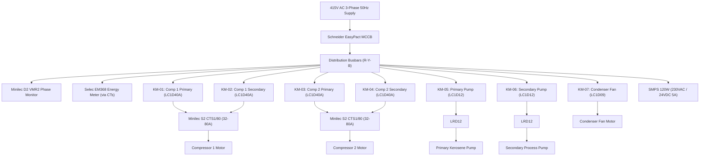

# DRAWING: D-001 POWER DISTRIBUTION SCHEMATIC

**Drawing Number:** D-001  
**Title:** 415V 3-Phase Main Power Distribution Schematic  
**Equipment:** `KIROSINE CHILLER -10 -01` & `KIROSINE CHILLER -10 -02`  
**Status:** VERIFIED  

## Schematic Diagram (Mermaid)

