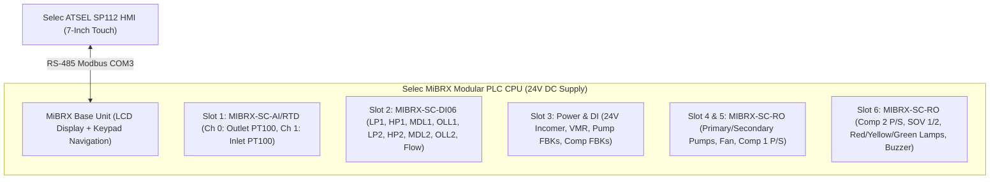

# DRAWING: D-002 PLC ARCHITECTURE DIAGRAM

**Drawing Number:** D-002  
**Title:** Selec MiBRX Modular PLC Hardware & Module Slot Architecture  
**Equipment:** `KIROSINE CHILLER -10 -01` & `KIROSINE CHILLER -10 -02`  
**Status:** VERIFIED  

## Architecture Overview (Mermaid)

