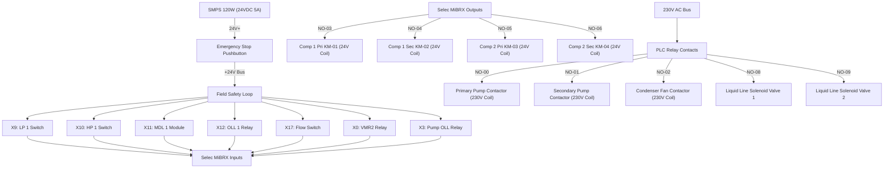

# DRAWING: D-003 CONTROL WIRING SCHEMATIC

**Drawing Number:** D-003  
**Title:** 24V DC & 230V AC Control Circuit Wiring Schematic  
**Equipment:** `KIROSINE CHILLER -10 -01` & `KIROSINE CHILLER -10 -02`  
**Status:** VERIFIED  

## Functional Diagram (Mermaid)

