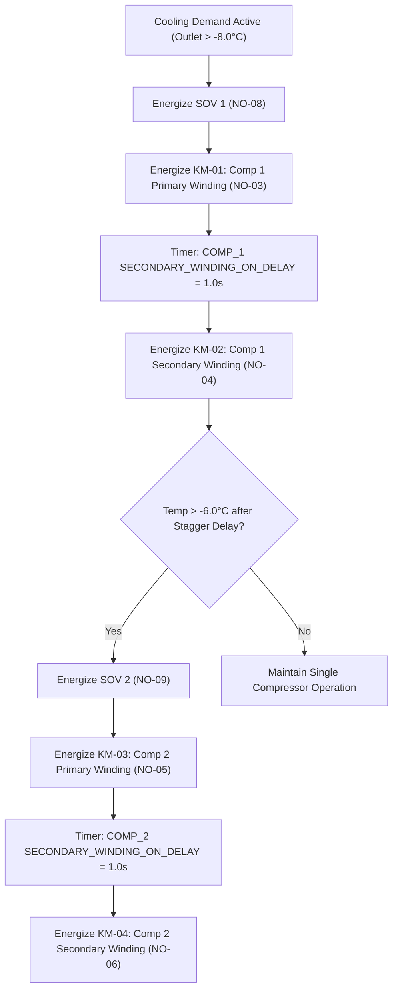

# DRAWING: D-004 COMPRESSOR CONTROL SCHEMATIC

**Drawing Number:** D-004  
**Title:** Dual Compressor Part-Winding Starter Schematics  
**Equipment:** `KIROSINE CHILLER -10 -01` & `KIROSINE CHILLER -10 -02`  
**Status:** VERIFIED  

## Staging & Part-Winding Sequence (Mermaid)

