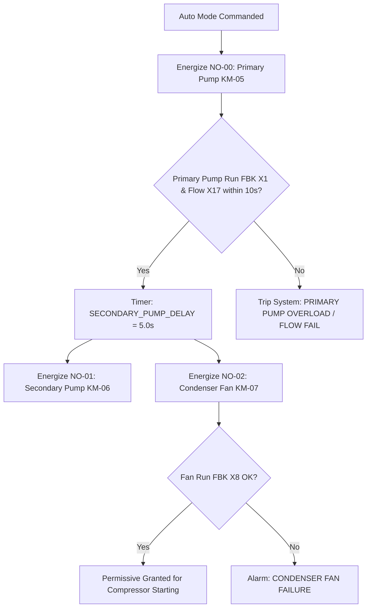

# DRAWING: D-005 PUMP & FAN CONTROL SCHEMATIC

**Drawing Number:** D-005  
**Title:** Primary & Secondary Pump and Condenser Fan Control Logic  
**Equipment:** `KIROSINE CHILLER -10 -01` & `KIROSINE CHILLER -10 -02`  
**Status:** VERIFIED  

## Pumping & Airflow Sequencing (Mermaid)

