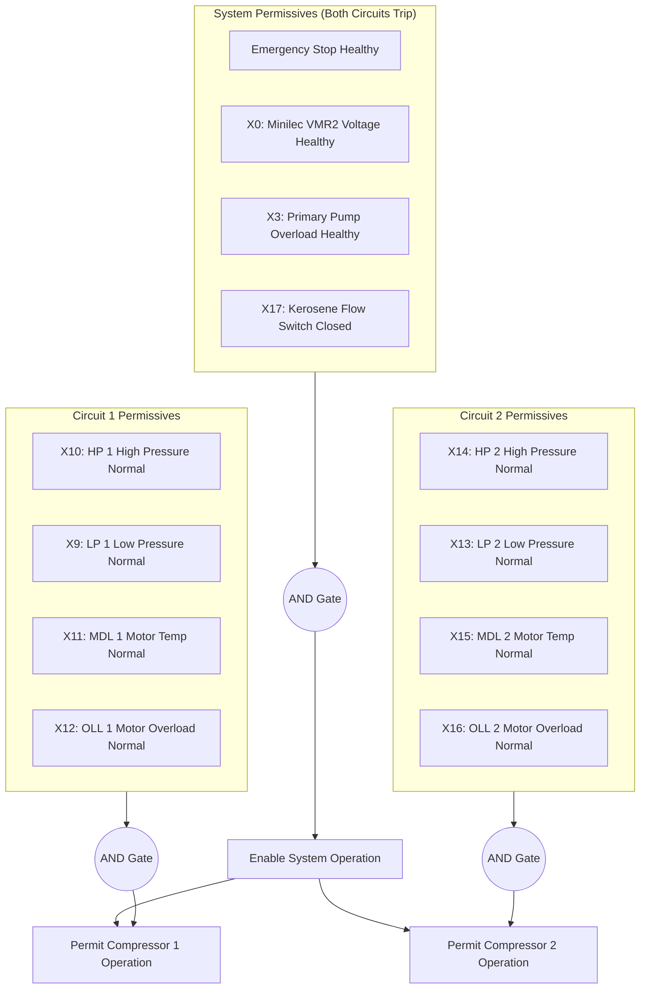

# DRAWING: D-006 INTERLOCK LOGIC DIAGRAM

**Drawing Number:** D-006  
**Title:** Master Safety Interlock Logic Diagram  
**Equipment:** `KIROSINE CHILLER -10 -01` & `KIROSINE CHILLER -10 -02`  
**Status:** VERIFIED  

## Safety Logic Tree (Mermaid)

