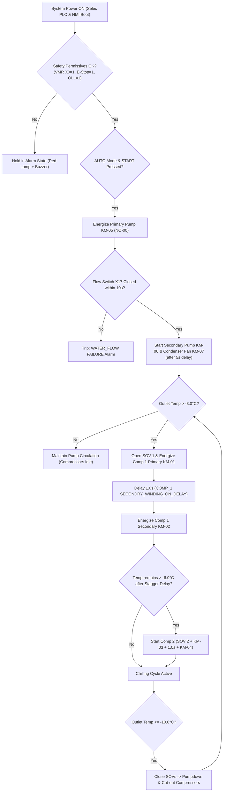

# DRAWING: D-007 AUTOMATIC SEQUENCE FLOWCHART

**Drawing Number:** D-007  
**Title:** Automatic Operating Sequence Flowchart  
**Equipment:** `KIROSINE CHILLER -10 -01` & `KIROSINE CHILLER -10 -02`  
**Status:** VERIFIED  

## Operational Flowchart (Mermaid)

