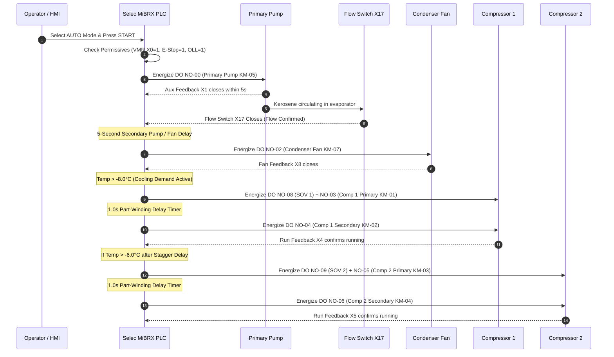

# ENGINEERING DOCUMENT: 04_CONTROL_PHILOSOPHY

**Document Number:** ED-CHIL-04  
**Revision:** Rev 1.0  
**Status:** APPROVED FOR ENGINEERING REFERENCE  
**Date:** 14-11-2026  
**Equipment Tags:** `KIROSINE CHILLER -10 -01` & `KIROSINE CHILLER -10 -02`  

---

## 1. Purpose & Scope
This document specifies the automatic sequencing, permissives, protection interlocks, capacity regulation, and shutdown logic executed by the Selec MiBRX PLC and Selec ATSEL SP112 HMI for the -10°C Kerosene Chiller.

---

## 2. Modes of Operation
The chiller control system provides two operating modes selectable via the HMI:
1. **OFF / RESET Mode:** All outputs de-energized. System alarms can be cleared via the `FAULT RESET` touch button.
2. **AUTO Mode:** The chiller operates completely autonomously according to process cooling demand and programmed permissives.

---

## 3. Automatic Start Sequence (AUTO Mode)

### 3.1 Step-by-Step Execution Sequence
1. **Initial Safety Permissive Scan:**
   - Before commanding any output, the PLC verifies:
     - `X0` (VMR_D2 3-Phase Voltage Monitor) is **CLOSED (24V High)**.
     - Hardwired Emergency Stop loop is closed (24V DC control bus healthy).
     - `X3` (Primary Pump Overload Relay) is **CLOSED (NC Healthy)**.
     - `X10` / `X14` (High Pressure Switches HP1 / HP2) are **CLOSED**.
2. **Primary Pump Starting:**
   - PLC energizes Digital Output `NO-00` (`PUMP_PRI_CMD`).
   - Contactor `KM-05` pulls in. Primary kerosene pump accelerates.
   - Auxiliary contact feedback `X1` must close within 5 seconds (`FLOAT FEEDBACK DELAY`); otherwise, alarm `PUMP RUN FAIL` is generated.
3. **Fluid Flow Confirmation:**
   - Primary pump flow establishes head pressure and displaces paddle flow switch `X17` (`WATER_FLOW`).
   - Digital input `X17` transitions from 0 to 1.
   - If `X17` fails to close within 10 seconds (`FAULT SENS DELAY`), the sequence aborts with alarm `FLOW FAILURE`.
4. **Condenser Fan & Secondary Pump Staging:**
   - After a 5-second delay (`SECONDARY_PUMP_DELAY`), PLC energizes:
     - Digital Output `NO-01` (`PUMP_SEC_CMD`) for the secondary process pump.
     - Digital Output `NO-02` (`FAN_CMD`) for the air-cooled condenser fan.
5. **Cooling Demand Evaluation:**
   - The PLC reads Chilled Kerosene Outlet Temperature via RTD Slot 1 (`TE-01`).
   - **Cooling Demand Active:** When $T_{outlet} > 	ext{SET POINT} + 	ext{DIFF} = -10.0^\circ	ext{C} + 2.0^\circ	ext{C} = \mathbf{-8.0^\circ	ext{C}}$.
   - **Cooling Demand Satisfied:** When $T_{outlet} \le \mathbf{-10.0^\circ	ext{C}}$.
6. **Compressor 1 Part-Winding Staged Start:**
   - PLC opens Liquid Line Solenoid Valve 1 via DO `NO-08` (`SOV 1`).
   - Simultaneously, PLC energizes Compressor 1 Primary Winding contactor via DO `NO-03` (`COMP1_PRI_CMD`). Contactor `KM-01` pulls in.
   - The compressor motor accelerates on its primary 50% winding, limiting starting current.
   - The PLC executes internal timer `COMP_1 SECONDARY_WINDING_ON_DELAY = 1.0 Second`.
   - At $t = 1.0	ext{ s}$, the PLC energizes DO `NO-04` (`COMP1_SEC_CMD`). Contactor `KM-02` pulls in, placing the full motor winding across the line.
   - Auxiliary run feedback `X4` confirms full operational state.
7. **Compressor 2 Lead/Lag Staging:**
   - If cooling demand exceeds the capacity of Compressor 1 (temperature remains above -6.0°C after a staging time delay, typically 180s), Compressor 2 is commanded ON following the exact identical Part-Winding sequence:
     - DO `NO-09` (`SOV 2`) and DO `NO-05` (`COMP2_PRI_CMD` / `KM-03`) energize.
     - After 1.0s delay, DO `NO-06` (`COMP2_SEC_CMD` / `KM-04`) energizes.
     - Auxiliary run feedback `X5` confirms running.

---

## 4. Temperature Regulation & Cut-out Sequence
1. As the kerosene temperature cools toward target:
   - When $T_{outlet}$ drops below -8.0°C, Compressor 2 unloads / shuts down (if running).
   - When $T_{outlet}$ reaches **-10.0 °C**, Compressor 1 initiates pump-down / cut-out:
     - DO `NO-08` (`SOV 1`) de-energizes (liquid line solenoid closes).
     - Compressor continues running briefly to pump down refrigerant from the evaporator until suction pressure drops or low pressure switch `X9` opens, or after a fixed timer (10s), at which point DO `NO-03` and `NO-04` de-energize.
   - The Primary Kerosene Pump continues running to maintain process circulation and temperature sensing.
2. When $T_{outlet}$ warms back up to **-8.0 °C**, the compressor restart sequence initiates.

---

## 5. Safety Shutdown & Alarm Handling
- **Immediate Hardwired Trip (E-Stop):** Depressing the panel E-Stop pushbutton immediately drops the 24V DC coil bus, dropping out all Schneider contactors (`KM-01` through `KM-07`) in less than 20 milliseconds, irrespective of PLC state.
- **Immediate PLC Safety Trip:** If `VMR_D2` (`X0`), `HP_1` (`X10`), `HP_2` (`X14`), `MDL_1` (`X11`), or `MDL_2` (`X15`) opens, the PLC instantly de-energizes the corresponding compressor outputs and lights the RED panel pilot lamp and audible buzzer.
