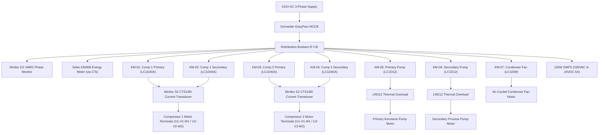

# ENGINEERING DOCUMENT: 08_POWER_WIRING

**Document Number:** ED-CHIL-08  
**Revision:** Rev 1.0  
**Status:** APPROVED FOR ENGINEERING REFERENCE  
**Date:** 14-11-2026  
**Equipment Tags:** `KIROSINE CHILLER -10 -01` & `KIROSINE CHILLER -10 -02`  

---

## 1. Incoming Power Supply & Distribution
The chiller electrical power system receives 415 V AC, 3-Phase, 4-Wire, 50 Hz power via bottom gland plates.

### 1.1 Incomer Switchgear
- **Main Breaker:** Schneider Electric EasyPact MCCB (Molded Case Circuit Breaker).
- **Incoming Busbars:** Heavy-gauge insulated copper busbars with heat-shrink sleeves color-coded:
  - **Red Phase (R):** Connected to MCCB Terminal L1.
  - **Yellow Phase (Y):** Connected to MCCB Terminal L2.
  - **Blue Phase (B):** Connected to MCCB Terminal L3.
- **Reference:** Photo `WhatsApp Image 2026-11-14 at 12.47.53.jpeg`.

---

## 2. Power Circuit Functional Architecture

---

## 3. Compressor Power Circuit Wiring
- **Starting Method:** Part-Winding Start (PW, 50% / 50% split).
- **Power Cables:** High-temperature multi-strand copper cables routed through slotted trunking.
- **Current Transducers:**
  - 3-phase power conductors pass through the window of the **Minilec S2 CTS1/80 Current Convertor** (Range 32 - 80 Amp) before reaching motor terminals.
  - Secondary output terminals from CTS1/80 connect to terminals 7, 8, 9, 10, 11, 12 of the **Minilec MPR D2** Motor Protection Relay.
- **Contactor Interlocking:** Contactors `KM-01` and `KM-02` operate in parallel during running conditions. `KM-01` provides starting torque; `KM-02` energizes 1.0 second later.
