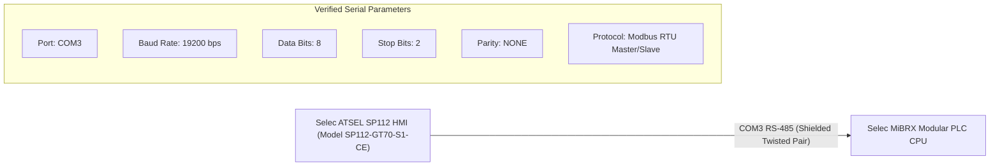

# ENGINEERING DOCUMENT: 10_COMMUNICATION_ARCHITECTURE

**Document Number:** ED-CHIL-10  
**Revision:** Rev 1.0  
**Status:** APPROVED FOR ENGINEERING REFERENCE  
**Date:** 14-11-2026  
**Equipment Tags:** `KIROSINE CHILLER -10 -01` & `KIROSINE CHILLER -10 -02`  

---

## 1. Network Overview
The chiller automation architecture comprises two distinct communication segments:
1. **Internal Chiller Subnet (Serial RS-485 Modbus RTU):** Interconnects the front-door Selec ATSEL SP112 HMI with the internal Selec MiBRX modular PLC base unit.
2. **Plant Process Network (Industrial Ethernet / Modbus TCP):** Connects the Skid HMI (R. Stahl HMI Systems GmbH) to the plant supervisory DCS/SCADA network.

---

## 2. Selec HMI-to-PLC Modbus RTU Link

### 2.1 Communication Diagnostic Fault Analysis
- **Observed Alarm Message:**
  - `Communication Error`
  - `Link Name: Link1`
  - `Link Interface: COM3`
  - `Parameter: 3-19200-8-2-NONE`
  - `Error Type: No data response`
  - `Error Info: 1#0x513(13)` / `1#0x569(7)`
  - Emergency indicator illuminated in red.
- **Root Cause & Troubleshooting:**
  1. **Emergency Stop Interlock:** When the emergency stop button is pressed, 24V control power to the PLC CPU may drop out while the HMI retains power from a separate branch, causing immediate "No data response".
  2. **Physical RS-485 Cabling:** Inspect terminals A (+) and B (-) on HMI COM3 port and PLC CPU communication port for loose screws or reversed polarity.
  3. **Modbus Slave Address Mismatch:** Verify PLC Modbus node address matches HMI target configuration (Default: Node 1).
